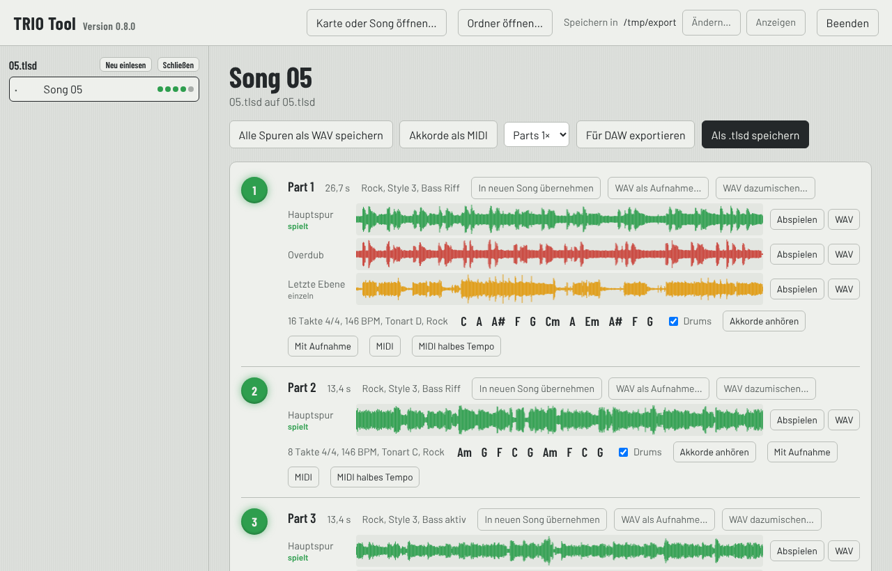

# TrioTool

Get your songs out of the **DigiTech TRIO+** band creator and looper, and
into your DAW.

TrioTool reads the `TRIOPLUS.DAT` on the pedal's microSD card (or songs
exported with the TRIO Manager), shows every part with its recordings and
the chords the pedal learned, and exports audio, MIDI and complete song
packages. It runs as a small app in your browser, on Windows, macOS, Linux
and a Raspberry Pi.



## Download

**Windows:** [TrioTool.exe from the latest release](https://github.com/wolfgang071wo/Trio-Plus-Data/releases/latest)
(no installation; double-click, the app opens in your browser; Windows may
warn because the file is not signed: "More info" → "Run anyway").

**Everything else:** Python 3.9 or newer, no further packages:

```sh
pip install .
trio gui                  # the app
trio --help               # the command line
```

## What it does

* **Read the card directly.** All 12 songs from `TRIOPLUS.DAT`, no TRIO
  Manager needed. The card is only read, never written.
* **See what the pedal saved.** When a card is opened again, TrioTool lists
  the parts the pedal stored since last time, or warns that it stored
  nothing (useful with a worn card slot).
* **Audio.** Every part as WAV: the main track, the overdub track, and the
  last overdub layer on its own (calculated from the two tracks).
* **Chords.** The chords, bars, time signature, tempo and key the pedal
  learned, decoded from the song file. Click a chord to correct it.
* **MIDI.** Chords, bass and stand-in drums for the part's genre, in the
  exact tempo of the loop. Preview it in the app, alone or together with
  the recording.
* **DAW package.** One folder per song: `Gitarre.wav` with all parts back
  to back and `Song.mid` with a tempo change per part, ready for Ardour,
  Reaper, Ableton, Bitwig and others.
* **Build songs.** Combine parts from different songs into a new song, or
  put a WAV file into a learned part, and load the result with the TRIO
  Manager.

The drums in the MIDI files are simple grooves written for TrioTool, not
the pedal's own drums, which are generated inside the pedal and are not
stored on the card.

## Status

Reading cards and songs, audio export, chord decoding and MIDI are tested
against the sample files in this repository and against a real card.
Writing songs (`build`, `import-wav`) produces valid files, but loading them
on the pedal has not been confirmed yet: keep a copy of your card.

How the song file and the card are organised is documented in
[docs/reference.md](docs/reference.md) and [docs/block_a.md](docs/block_a.md).

## Kurz auf Deutsch

TrioTool holt Songs vom DigiTech TRIO+: direkt von der SD-Karte, mit
Wellenformen, erkannten Akkorden, WAV- und MIDI-Export und einem Paket für
die DAW. Für Windows einfach `TrioTool.exe` aus den Releases laden und
starten. Die Oberfläche ist deutsch.

## Credits and licence

TrioTool started as a fork of
[Trio-Plus-Data](https://github.com/giveabit/Trio-Plus-Data) by giveabit,
whose reverse-engineering notes, sample files and original tool (still in
`The_Trio_Tool/` and `Trio_GUI/`) made this possible. Some layout details
were cross-checked with [trio-updater](https://github.com/freimann/trio-updater)
by freimann. Fonts: Barlow, SIL Open Font License
(`trioplus/gui/static/fonts/OFL.txt`).

DigiTech, TRIO+ and TRIO Manager are trademarks of their owners. This
project is not affiliated with or endorsed by them.

Licensed under the GNU General Public License v3.0, see [LICENSE](LICENSE).
